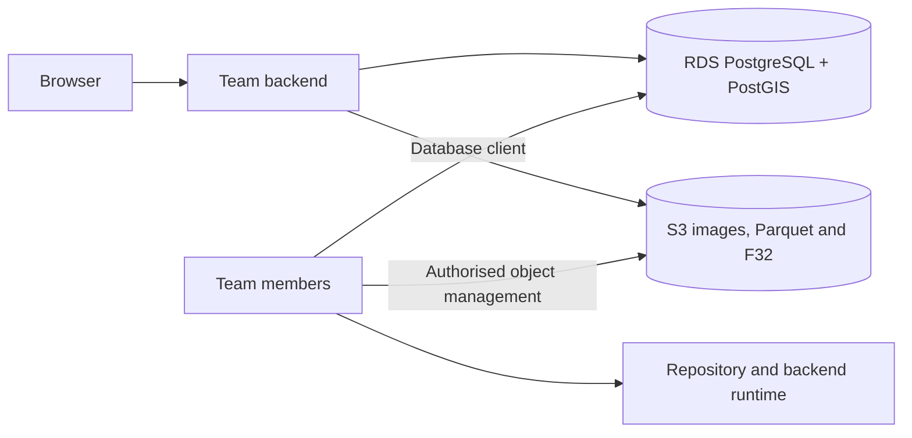

# Initial Five-Borehole AWS Deployment and Team Handoff

2026-09-24 update: retain this original five-borehole plan as history. Current delivery covers eight boreholes, 39 tables, 13 datasets, 654,778 complete samples, 4,160 row images and 24 complete spectral matrices. The three reference boreholes are now imported. Use [current delivery instructions](MULTI_DATASET_DELIVERY.md), the latest backup pointer and object manifest. Older release IDs and counts below are historical; no cloud operations have been performed.

The selected approach is manual upload; see the [AWS manual upload guide](AWS_MANUAL_UPLOAD_GUIDE.md). Proposed automated scripts below are not the selected workflow; the user performs cloud operations.

2026-09-10: plan to deploy the five processed boreholes for team use on AWS. Sealing, rerun and concurrency improvements remain deferred; vertical crop overlap does not block this iteration. This plan did not create resources, upload files or modify databases.

Initial scope: media release `fd02659c-dc3d-52ea-a8eb-c032b91e7624`, five boreholes, 261,892 samples, 249 original tray images, 1,361 row images and 8 complete spectral matrices. Preserve VSWIR/TIR, s/u, physical depths and original mineral weights. Exclude the three multi-dataset reference boreholes; expansion to 2000 boreholes and high-resolution downloads are outside scope.

**Cloud responsibilities**

| Location | Contents | Owner/use |
|---|---|---|
| RDS PostgreSQL + PostGIS | 36 tables, samples, depths, wavelengths, log catalogue, image associations, locations and provenance | Backend SQL reads; maintainers manage schemas and authorised data |
| S3 | PNG/tray images, Parquet, F32, evidence, manifests and backups | Backend reads by object key; authorised members manage objects |
| Repository and backend runtime | Python/FastAPI, S3 adapter and deployment templates | API/deployment owner |

Dense mineral values reside in Parquet and spectra in F32. A database backup and images alone are insufficient; the backend must read these objects. S3 stores files rather than executing Python.

**Six steps in order**

1. Confirm the team AWS target and migration owner.

   Record the team account, region, existing RDS, S3 bucket, backend location and migration owner without passwords. Confirm capacity and budget; keep RDS, S3 and the backend in the same region where possible.

   The target must support the backup's PostGIS types and functions. The local versions were PostgreSQL 17.4 / PostGIS 3.6.2; verify target extensions and permissions before choosing a compatible combination. [RDS PostGIS](https://docs.aws.amazon.com/AmazonRDS/latest/UserGuide/Appendix.PostgreSQL.CommonDBATasks.PostGIS.html).

2. Assemble the one-off handoff package.

   Reuse prepared outputs without repeating steps 20-29. Compare the current database, backup and manifest before handoff; export again only if they differ.

   | Content | Existing source / planned output |
   |---|---|
   | Database backup | `.dump` referenced by `reports/latest_database_backup.json`, recently about 10.24 MB |
   | Upload manifest | `reports/deployment_asset_manifest.json`; latest current-release coverage: 2,810 unique paths, approximately 2.401 GB |
   | Object files | Referenced images, Parquet, F32 and evidence, retaining source identities |
   | Data documentation | `schema_dictionary.md`, `source_to_table_mapping.md`, `MEDIA_READ_CONTRACT.md` |
   | Code and dependencies | Required migrations, reference readers and helpers, `requirements.txt` and configuration templates |
   | Validation baseline | Current release ID, per-borehole counts and selected depth/result/spectrum/image examples |
   | Team handoff notes | Accepted limitations, permitted changes and remaining work |

   Exclude `runtime/local_config.json`, PostgreSQL runtime data, virtual environments and temporary caches. Archive raw materials by manifest. Online reads do not require local processing scripts; record input digests without adding mandatory sealing.

3. Upload objects and restore the backup into an empty cloud database.

   Use `data/<original_etl4_relative_path>` as the initial S3 layout. Record keys, sizes and verification results without local drive letters. Backups may use `backups/`, but SQL reads require restoration to RDS.

   Prepare compatible PostGIS, restore application schemas, data, constraints and indexes, and recreate cloud roles. Retain historical revisions but validate the selected current release and its object coverage. Check older object coverage before exposing historical releases. [RDS data import](https://docs.aws.amazon.com/AmazonRDS/latest/UserGuide/PostgreSQL.Procedural.Importing.html).

   Register verified objects in `asset_location` with `backend=s3`, a configured bucket `root_key`, relative `object_key` and matching `asset.sha256`. Cloud readers select S3 replicas. Moving storage does not recreate business IDs, samples or row associations.

4. Integrate cloud readers in the team backend.

   The `_media_reader.py` reference currently selects local replicas through `local_asset()` and has no S3 client. Cloud deployment requires a reader adapter.

   | Data | Required reader implementation |
   |---|---|
   | Collars, datasets, samples and physical depth | Query RDS by release, dataset, axis and sample_no |
   | Row image | Resolve the associated S3 object key and return an accessible image endpoint |
   | Mineral results and weights | Read the Parquet row group and sample identified by `data_chunk` |
   | Complete spectra | Read F32 byte ranges from `spectral_block` and combine with `spectral_stream.wavelengths` |
   | Pointer | Retain sample_index_linear v1; vertical crop bounds do not determine horizontal position |

   The API owner can implement independent readers. Serve images through the backend or temporary signed URLs; store stable object keys. Configure CORS if browsers fetch objects directly. [S3 signed URLs](https://docs.aws.amazon.com/AmazonS3/latest/userguide/using-presigned-url.html).

5. Provide team access and define permitted modifications.

   | Team task | Handoff requirements |
   |---|---|
   | Pages, API changes, queries and calculations | Repository/backend deployment access plus database and S3 read permissions |
   | Inspect or troubleshoot data | RDS connection settings, database client instructions and individual database roles |
   | Maintain fields, tables, file locations or objects | Relevant database and S3 write permissions, with scripts or change records |
   | Edit existing samples, metadata or image associations | Define table-specific rules under existing triggers; AWS permissions alone cannot enable these edits |

   **Existing triggers reject business-record UPDATE/DELETE.** They remain in place during this iteration. Direct edits require table-specific rules; website reads and API code changes are unaffected.

   Use individually authorised AWS identities and a backend runtime role for S3. Configure database accounts separately. Handoff includes endpoint, database, TLS settings, bucket/prefix and roles; transfer credentials separately. [AWS team access](https://docs.aws.amazon.com/singlesignon/latest/userguide/what-is.html).

6. Complete a cloud functionality check and hand off.

   Check migration against the confirmed five-borehole baseline: 261,892 samples, 1,361 row images and 8 spectral matrices. Verify object coverage and inspect first/last samples and row boundaries for depth, original mineral weights, complete spectra, images and pointer positions.

   Retain the 05KCD001 sample 129→130 comparison: equal depths, distinct samples and a row transition that resets pointer position. Preserve missing TIR availability without substituting other bands.

   Verify reads independently of the original computer, database and folders. Record database delivery and website validation separately. Retain a deployment baseline backup and object manifest; a full remote disaster-recovery exercise is outside this iteration.

**Proposed scripts use separate numbered entry points**

The following scripts were proposed but not created or executed. Team members may provision resources directly in AWS.

| Proposed script | Purpose |
|---|---|
| `31_prepare_cloud_handoff.py` | Check the delivery baseline and assemble manifests, required files and handoff notes |
| `32_check_aws_target.py` | Check connections, PostGIS and restore permissions without creating resources |
| `33_upload_cloud_assets.py` | Upload manifest objects, verify and record receipts; skip verified objects |
| `34_restore_cloud_database.py` | Restore to an explicitly empty target, configure roles and register verified S3 locations |
| `35_verify_cloud_delivery.py` | Check cloud database/files and produce reproducible results; excludes API review |

Confirm the AWS target and assemble the local handoff first, followed by upload, restoration, reader integration and cloud checks. Reprocessing, sample expansion and deferred improvements remain outside this iteration.
