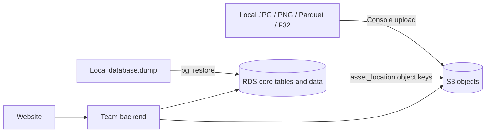

# Manual AWS Deployment for Eight ETL4 Boreholes

2026-09-24: updated to eight boreholes, adding three multi-dataset boreholes. Use [multi-dataset delivery](MULTI_DATASET_DELIVERY.md) and current manifests. This update changed data scope and counts without rechecking AWS interfaces/pricing or performing cloud operations.

Written 2026-09-10 for manual resource selection, upload, restoration and handoff. Example names are placeholders. This guide did not create resources or perform cloud operations; console labels may vary.

Use the AWS console for resources and S3 uploads, local pgAdmin for database access, and PostgreSQL's `pg_restore` for restoration. Earlier deferred improvements remain outside this guide.

**Four components**

| Name | Project meaning | Operation |
|---|---|---|
| RDS instance | AWS-managed database server | Create an instance and record endpoint/port |
| PostgreSQL database and schema | etl4_core database with 39 tables in core | Restore definitions, data, indexes and constraints from `.dump` |
| S3 bucket and object | A bucket holds objects containing file bytes and metadata | Upload a local folder through the console |
| `asset_location` | Database record locating a file | Add an S3 replica location for the existing asset |

The RDS endpoint is a database hostname. An S3 bucket and object key locate a file; folder-like components are key prefixes. A schema is a namespace for tables.



**Batch contents**

| Content | Storage format/location |
|---|---|
| Boreholes, datasets, sample numbers, depths and source metadata | RDS tables |
| Image/sample associations, crop bounds and pointer rules | RDS tables |
| VSWIR/TIR wavelength axes, matrix layouts and byte-block indexes | RDS tables |
| 945 tray images | Original JPG files in S3 |
| 4,160 official row images | Existing PNG files in S3 |
| Dense mineral names and weights | Existing Parquet in S3; lookup indexes in RDS |
| 24 complete spectral matrices | Original F32 files in S3 |
| Other source files and evidence | Store in S3 according to the manifest |
| `.dump` | Restore to RDS; optionally archive under the S3 backups prefix |

Store images as ordinary objects. PostGIS handles geographical locations. Original archives may include CSVs, while cleaned Parquet remains the result-reading source.

2026-09-24 baseline: 654,778 current samples and 638,331 selected for the 3D continuation view. The database contains 1,309,556 sample rows including history. The manifest records 9,699 asset/location entries covering **8,571 unique files, 6,722,411,576 bytes (about 6.722 GB)**. These include 4,160 official row images plus comparison images/evidence. The approximately 27.02 MB database dump excludes object files.

**Step 1: confirm account, region and budget; prepare local tools**

Confirm the AWS account, region and existing RDS/S3 with the team. Reuse authorised resources and restore only into an empty target. Account ownership determines administration and billing; keep RDS, S3 and the backend in one region where possible.

Use AWS's official sign-in, owner MFA and individually authorised team identities. AWS and PostgreSQL permissions are separate.

Create budget alerts for instance, storage, backup, S3 request and transfer costs. Eligibility depends on the account; alerts are not a hard spending cap. [AWS budgets](https://docs.aws.amazon.com/cost-management/latest/userguide/budgets-create.html).

Use the existing local PostgreSQL 17 tools for the PostgreSQL 17.4 backup. Confirm these files exist:

```text
C:\Program Files\PostgreSQL\17\bin\pg_restore.exe
C:\Program Files\PostgreSQL\17\bin\psql.exe
```

Use the pgAdmin 4 desktop application to inspect cloud tables. Desktop file paths refer to this computer; server-mode paths refer to the server.

**Step 2: locate the upload files**

Current backup:

```text
C:\path\to\project\etl4\database\backups\etl4_multi_177d1720-d327-534c-90da-5e3f517d8807_20260924T075109Z.dump
```

Before execution, compare the selected backup with [latest_database_backup.json](reports/latest_database_backup.json). SHA256:

```text
23dd625fab1cf7b45b14f6cb062d5cf583e2eb0b44daa4307e24f32113cc1a2b
```

Check in PowerShell:

```powershell
Get-FileHash -Algorithm SHA256 -LiteralPath 'C:\path\to\project\etl4\database\backups\etl4_multi_177d1720-d327-534c-90da-5e3f517d8807_20260924T075109Z.dump'
```

The backup contains definitions, indexes and triggers for 39 tables. An independent restoration verified table content, structure, views, releases and 3D selection counts. Reconfirm the migration baseline if the local database has since changed.

Object sources are listed in deployment_asset_manifest.json (`./reports/deployment_asset_manifest.json`, historical file not included here), across eight borehole directories, `processing` and `database`. Select only manifest files; the whole etl4 directory contains local runtime material.

The following PowerShell prepares a dedicated upload folder by checking and copying manifest files locally. It requires approximately 6.722 GB additional space and does not contact AWS or delete sources.

```powershell
$ErrorActionPreference = 'Stop'
$etlSource = (Resolve-Path -LiteralPath 'C:\path\to\project\etl4').Path
$uploadRoot = Join-Path $etlSource 'database\manual_upload_files'
if (Test-Path -LiteralPath $uploadRoot) { throw 'Target directory exists. Inspect its contents; this step will not overwrite it.' }
$uploadManifest = Get-Content -Raw -LiteralPath (Join-Path $etlSource 'database\reports\deployment_asset_manifest.json') | ConvertFrom-Json
if ($uploadManifest.release_id -ne '177d1720-d327-534c-90da-5e3f517d8807') { throw 'Manifest release differs; check before continuing.' }
$localItems = @($uploadManifest.locations | Where-Object { $_.backend -eq 'local' -and $_.root_key -eq 'etl4' -and $_.access_status -eq 'verified_local' })
$groupedItems = @($localItems | Group-Object -Property object_key)
if ($groupedItems.Count -ne 8571) { throw 'File count differs; check the manifest.' }
$sourcePrefix = $etlSource.TrimEnd('\') + '\'
$uploadPrefix = [IO.Path]::GetFullPath($uploadRoot).TrimEnd('\') + '\'
New-Item -ItemType Directory -Path $uploadRoot | Out-Null
foreach ($itemGroup in $groupedItems) {
    $item = $itemGroup.Group[0]
    $expectedHashes = @($itemGroup.Group.verified_sha256 | Sort-Object -Unique)
    if ($expectedHashes.Count -ne 1) { throw "Conflicting hashes for path: $($item.object_key)" }
    $sourceFile = [IO.Path]::GetFullPath((Join-Path $etlSource $item.object_key))
    $targetFile = [IO.Path]::GetFullPath((Join-Path $uploadRoot ('data/' + $item.object_key)))
    if (-not $sourceFile.StartsWith($sourcePrefix, [StringComparison]::OrdinalIgnoreCase)) { throw 'Source path is outside the source directory.' }
    if (-not $targetFile.StartsWith($uploadPrefix, [StringComparison]::OrdinalIgnoreCase)) { throw 'Target path is outside the upload directory.' }
    $actualHash = (Get-FileHash -Algorithm SHA256 -LiteralPath $sourceFile).Hash.ToLowerInvariant()
    if ($actualHash -ne $expectedHashes[0]) { throw "File hash mismatch: $($item.object_key)" }
    New-Item -ItemType Directory -Path ([IO.Path]::GetDirectoryName($targetFile)) -Force | Out-Null
    Copy-Item -LiteralPath $sourceFile -Destination $targetFile
}
Get-ChildItem -LiteralPath (Join-Path $uploadRoot 'data') -File -Recurse | Measure-Object -Property Length -Sum
```

Expect `Count=8571` and `Sum=6722411576`. An interrupted copy is incomplete. The guide does not execute this preparation or delete failed directories.

Expected layout:

```text
manual_upload_files/
  data/
    05KCD001/
    07THD002/
    07THD003/
    09ATD015/
    09ATD019/
    processing/
    database/
```

Copy only manifest files; the selected `database` subdirectory is not the full local database directory. Keep online objects individually readable. S3 does not automatically extract ZIP archives.

**Step 3: create/select an S3 bucket and upload**

Open S3 → Buckets → Create bucket:

| Setting | Trial choice |
|---|---|
| Region | Team-selected region |
| Bucket type | General purpose |
| Bucket name | Unique valid lowercase name, such as `etl4-core-demo-team-randomsuffix` |
| Object Ownership | Retain ACLs disabled |
| Block Public Access | Keep all options enabled |
| Bucket Versioning | Optional for overwrite recovery; old versions consume storage. Object Lock is unnecessary |
| Default encryption | SSE-S3 for the trial, or the existing team bucket configuration |

Use an authorised prefix in an existing bucket. Private objects can be served using temporary signed URLs. [S3 setup](https://docs.aws.amazon.com/AmazonS3/latest/userguide/GetStartedWithS3.html), [signed URLs](https://docs.aws.amazon.com/AmazonS3/latest/userguide/using-presigned-url.html).

At the bucket root, follow these steps:

1. Objects → Upload.
2. Select Add folder and choose the local **data folder** inside `manual_upload_files`.
3. Confirm preview keys begin with `data/05KCD001/…`, `data/database/…` and the expected prefixes.
4. Use S3 Standard for online images and numerical data; archive classes may require restoration before reads.
5. Click Upload, wait for completion and retry recorded failures.

Upload the local `data` folder from the bucket root to avoid `data/data/`. Verify full object keys. This batch fits console upload limits. [S3 uploads](https://docs.aws.amazon.com/AmazonS3/latest/userguide/upload-objects.html).

Inspect object Key, Size and Content-Type. Use `image/png` and `image/jpeg`; binary F32/Parquet files need backend readers rather than browser previews. [Object metadata](https://docs.aws.amazon.com/AmazonS3/latest/userguide/UsingMetadata.html).

Example object key for an existing row image:

```text
data/database/media_releases/74ef7579d3e825faf249bb56c523f9cb0a5f986b56a232e4c48b750d96eda9c6/crops/d3c51d8a-3c91-553b-89dd-cee9e926979d/9ee88848-2053-477d-9844-51035992011/0092101d-e6b3-5fce-a7e0-eb7c102a560a.png
```

Use authorised console Open/Download. A private unsigned URL returning 403 does not indicate upload failure. Serve images through the backend or signed URLs; configure the actual site origin for direct browser CORS.

Optionally archive dumps under `backups/2026-09-10/` and manifests under `manifests/2026-09-10/`. These objects do not automatically create RDS tables.

**Step 4: create an RDS PostgreSQL instance**

Historical compatibility note: the backup used PostgreSQL 17.4 / PostGIS 3.6.2. The AWS table consulted listed PostgreSQL 18.4 with PostGIS 3.6.3 and PostgreSQL 17 with 3.5.x. A stable PostgreSQL 18 / PostGIS 3.6.3 target was a candidate, not an RDS-tested combination. Verify available extensions before restoration and data afterward. [AWS extension versions](https://docs.aws.amazon.com/AmazonRDS/latest/PostgreSQLReleaseNotes/postgresql-extensions.html).

Open RDS → Databases → Create database → Standard create and select Amazon RDS PostgreSQL. Key settings:

| Setting | Initial eight-borehole trial |
|---|---|
| Engine | PostgreSQL, using a verified stable compatible version |
| Template | Free tier if eligible and offered; otherwise Dev/Test with cost review |
| Availability | Single-AZ / Single DB instance for the initial trial |
| DB instance identifier | Example: `etl4-demo-db`, the instance name |
| Master username | For example, `postgres` for initialisation/restoration; create a separate backend reader |
| Credentials | Store managed passwords in a password manager; check separate costs if using Secrets Manager |
| Instance class | Smallest suitable option for the selected region/version; review estimated cost |
| Storage | gp3 at an allowed initial capacity; approximately 191 MB local usage does not determine provisioned RDS capacity or cost |
| Initial database name | `etl4_core`, distinct from the instance name |
| Database port | 5432 for this RDS target; local port 55432 is separate |
| Backup retention | Initially 7 days; later manual backups are separate from automated retention |

Use existing team infrastructure where available. Review optional proxies, replicas, Multi-AZ, region, networking and estimated costs before creation; wait for Available. [Create RDS](https://docs.aws.amazon.com/AmazonRDS/latest/UserGuide/USER_CreateDBInstance.html), [settings](https://docs.aws.amazon.com/AmazonRDS/latest/UserGuide/USER_CreateDBInstance.Settings.html).

**Step 5: connect the local computer to RDS**

Choose the applicable connection route:

| Team environment | Approach |
|---|---|
| Existing private RDS, VPN/tunnel or cloud management host | Use the existing team connection route |
| New isolated trial instance restored from a local computer | Temporarily enable Publicly accessible and allow only the actual public IPv4 `/32` on port 5432 |

For public access, choose a VPC and DB subnet group with public routing. Publicly accessible alone does not create missing routes. Confirm the team network before adding paid facilities such as NAT. [AWS networking](https://docs.aws.amazon.com/AmazonRDS/latest/UserGuide/USER_VPC.Scenarios.html).

Open RDS → Connectivity & security → VPC security groups → Inbound rules → Edit inbound rules:

```text
Type: PostgreSQL
Protocol: TCP
Port: 5432
Source: My IP (your actual public IPv4/32)
Description: temporary manual import
```

Allow only the precise public source IP, never `0.0.0.0/0` or `::/0`. Update it after network changes. Remove temporary public rules after verifying the backend's private connection. [RDS security groups](https://docs.aws.amazon.com/AmazonRDS/latest/UserGuide/Overview.RDSSecurityGroups.html).

Record Endpoint and Port from the instance page. Use the actual hostname, such as `db.example.com`, without `https://`.

**Step 6: connect through pgAdmin and install PostGIS**

Download the appropriate CA bundle from [AWS certificates](https://docs.aws.amazon.com/AmazonRDS/latest/UserGuide/UsingWithRDS.SSL.html); commercial regions may use global-bundle.pem as documented. Example local destination:

```text
C:\path\to\project\etl4\database\manual_certs\global-bundle.pem
```

This public CA certificate is not a database credential and does not need uploading to S3.

In pgAdmin, register `AWS-etl4-demo` under Servers. Set the endpoint, port 5432, maintenance database `etl4_core`, username and password. Use SSL mode `verify-full` and the downloaded PEM as root certificate; no client certificate/key is needed. [pgAdmin fields](https://www.pgadmin.org/docs/pgadmin4/latest/server_dialog.html), [RDS TLS](https://docs.aws.amazon.com/AmazonRDS/latest/UserGuide/PostgreSQL.Concepts.General.SSL.html).

If `etl4_core` is absent, connect to maintenance database `postgres`, create `etl4_core` through pgAdmin, then switch to it.

Select etl4_core under the AWS connection and open Query Tool:

```sql
SELECT current_database(), current_user, version();
SELECT ssl FROM pg_stat_ssl WHERE pid = pg_backend_pid();
SELECT name, version, installed
FROM pg_available_extension_versions
WHERE name = 'postgis'
ORDER BY version;
SELECT to_regnamespace('core') AS existing_core_schema;
```

Verify database etl4_core, the selected RDS version, SSL=true and the expected PostGIS extension. Before restoration, existing_core_schema should be NULL; inspect any existing core data first.

If PostGIS 3.6.3 is listed and not installed, run:

```sql
CREATE EXTENSION postgis WITH SCHEMA public VERSION '3.6.3';
SELECT postgis_full_version();
CREATE SCHEMA core;
```

Install only a listed compatible version. This schema references `public.geometry`, so install PostGIS in public using the RDS administrator. Extra tiger, raster and topology extensions are unnecessary. [PostGIS setup](https://docs.aws.amazon.com/AmazonRDS/latest/UserGuide/Appendix.PostgreSQL.CommonDBATasks.PostGIS.html).

`CREATE SCHEMA core` creates an empty namespace. The tested `--schema=core` restore omits namespace creation, so create it first. On retries, confirm an existing core is empty before proceeding.

**Step 7: restore tables and data**

Run PostgreSQL's `pg_restore` in local PowerShell. It restores tables and data through the target database connection.

Set these three local variables, using the actual console endpoint:

```powershell
$pgBin = 'C:\Program Files\PostgreSQL\17\bin'
$rdsHost = 'YOUR_RDS_ENDPOINT'
$dbDump = 'C:\path\to\project\etl4\database\backups\etl4_multi_177d1720-d327-534c-90da-5e3f517d8807_20260924T075109Z.dump'
$env:PGSSLMODE = 'verify-full'
$env:PGSSLROOTCERT = 'C:\path\to\project\etl4\database\manual_certs\global-bundle.pem'
```

Inspect the local backup listing:

```powershell
& "$pgBin\pg_restore.exe" --list $dbDump
```

The backup listing includes `SCHEMA core` and `TABLE core scan_sample`, and identifies PostgreSQL 17.4. Use PostgreSQL 17 tools for this backup; future cloud backup tools must match the server's major version.

Confirm the target is empty and the endpoint correct, then run:

```powershell
& "$pgBin\pg_restore.exe" --host $rdsHost --port 5432 --username postgres --password --dbname etl4_core --schema=core --no-owner --no-acl --single-transaction --exit-on-error --verbose $dbDump
if ($LASTEXITCODE -ne 0) { throw 'Restore failed. Save the error output before registering locations.' }
```

Replace `--username` if the administrator is not postgres. Enter the password at the hidden prompt; keep it out of commands and documents.

| Option | Meaning |
|---|---|
| `--host / --port / --dbname` | Identify the target remote database |
| `--schema=core` | Restore project objects into the prepared core namespace; PostGIS is already in public |
| `--no-owner --no-acl` | Recreate cloud ownership and grants instead of restoring local roles |
| `--single-transaction` | Restore atomically to avoid partial core tables on failure |
| `--exit-on-error` | Stop on errors |
| `--verbose` | Show table creation, data loading and constraints |

`pg_restore` handles tables, data, indexes and foreign keys. Do not pre-run migrations 001-006 for a full restore. This command contains no `--clean` or DROP. [pg_restore](https://www.postgresql.org/docs/17/app-pgrestore.html).

Refresh pgAdmin: Databases → etl4_core → Schemas → core → Tables. Expect 39 tables; use View/Edit Data to inspect them. Existing triggers still restrict edits.

**Step 8: inspect restored tables**

Run in the AWS target database Query Tool:

```sql
SELECT count(*) AS table_count
FROM information_schema.tables
WHERE table_schema = 'core' AND table_type = 'BASE TABLE';

SELECT release_id FROM core.active_release WHERE singleton;

SELECT b.source_hole_id, sum(a.sample_count) AS full_sample_count,
       count(*) AS dataset_count
FROM core.active_release ar
JOIN core.release_dataset rd ON rd.release_id = ar.release_id
JOIN core.dataset d ON d.id = rd.dataset_id
JOIN core.borehole b ON b.id = d.borehole_id
JOIN core.sample_axis a ON a.dataset_revision_id = rd.dataset_revision_id
GROUP BY b.source_hole_id
ORDER BY b.source_hole_id;

SELECT count(*) AS current_samples
FROM core.scan_sample s
JOIN core.sample_axis a ON a.id = s.axis_id
JOIN core.release_dataset rd ON rd.dataset_revision_id = a.dataset_revision_id
JOIN core.active_release ar ON ar.release_id = rd.release_id;

SELECT count(*) AS current_row_images
FROM core.image_region_asset ra
JOIN core.release_dataset rd ON rd.dataset_revision_id = ra.dataset_revision_id
JOIN core.active_release ar ON ar.release_id = rd.release_id;

SELECT count(*) AS current_spectral_arrays
FROM core.spectral_array a
JOIN core.release_dataset rd ON rd.dataset_revision_id = a.dataset_revision_id
JOIN core.active_release ar ON ar.release_id = rd.release_id;

SELECT count(*) AS selected_3d_samples
FROM core.v_borehole_composite_samples s
JOIN core.active_release ar ON ar.release_id = s.release_id;
```

Expect 39 tables, release `177d1720-d327-534c-90da-5e3f517d8807`, 654,778 current samples, 4,160 row images and 24 arrays. Original five counts: 22,356 / 116,424 / 54,432 / 46,030 / 22,650. Added 12CADD001 / 14KDD001 / 15EIS001: 79,736 / 38,450 / 274,700 across complete datasets. The full `core.scan_sample` count of 1,309,556 includes history.

Expect 638,331 samples in the 3D selection and 654,778 complete samples across 2D dataset views. Find both views under Schemas → core → Views.

Query a real sample and collar geometry:

```sql
SELECT sample_no, md_m, section_sample_no
FROM core.scan_sample
WHERE axis_id = 'b9ba28cd-0216-5314-83df-f6247b0f56b6'
  AND sample_no = 15;

SELECT source_name, ST_AsText(collar_geom) AS collar, ST_SRID(collar_geom) AS srid
FROM core.borehole_revision;
```

Expect depth 62.50175 m and a POINT collar with SRID 4326. These are migration checks, not a complete source-data revalidation.

**Step 9: register cloud file locations**

Map local `09ATD019/images/example.jpg` to `data/09ATD019/images/example.jpg`. Add an S3 replica for the same `asset_id` while retaining sample and row identities.

Initially register `uploaded_unverified`. The required `verified_sha256` value is the expected asset hash; `access_status` distinguishes completed remote verification. Agree supported states with the S3 reader owner.

Preview new object keys in the target Query Tool:

```sql
SELECT l.asset_id, l.object_key AS old_local_key,
       'data/' || l.object_key AS proposed_s3_key
FROM core.asset_location l
JOIN core.asset a ON a.id = l.asset_id
JOIN core.release_dataset rd ON rd.dataset_revision_id = a.dataset_revision_id
WHERE rd.release_id = '177d1720-d327-534c-90da-5e3f517d8807'
  AND l.backend = 'local' AND l.root_key = 'etl4'
ORDER BY l.object_key;
```

Expect 9,699 locations covering 8,571 unique objects. Confirm keys, then run the explicit transaction first with ROLLBACK as a preview:

```sql
BEGIN;
INSERT INTO core.asset_location
  (id, asset_id, backend, root_key, object_key, access_status, verified_sha256)
SELECT gen_random_uuid(), l.asset_id, 's3', 'etl4_s3_primary',
       'data/' || l.object_key, 'uploaded_unverified', a.sha256
FROM core.asset_location l
JOIN core.asset a ON a.id = l.asset_id
JOIN core.release_dataset rd ON rd.dataset_revision_id = a.dataset_revision_id
WHERE rd.release_id = '177d1720-d327-534c-90da-5e3f517d8807'
  AND l.backend = 'local' AND l.root_key = 'etl4'
ON CONFLICT (asset_id, backend, root_key, object_key) DO NOTHING;

SELECT count(*) AS registered_locations, count(DISTINCT object_key) AS unique_objects
FROM core.asset_location
WHERE backend = 's3' AND root_key = 'etl4_s3_primary';
ROLLBACK;
```

After confirming preview counts of 9,699 / 8,571, rerun the block with final `COMMIT;` replacing `ROLLBACK;`. This registers locations only. Keep local provenance records; cloud readers select `backend='s3'`.

Map logical `root_key='etl4_s3_primary'` to the bucket and region in deployment configuration. Store neither long-lived AWS keys nor expiring URLs in the database.

**Step 10: record upload and verification coverage**

Check upload failures, keys, sizes and totals under `data/`. Exclude zero-byte folder markers from the 8,571 file count. Sample originals, row images, Parquet and available F32 files per borehole; download selected objects and compare `Get-FileHash -Algorithm SHA256` against the manifest.

S3 transfer checks do not verify that the chosen file belongs to the intended dataset. ETags, multipart checksums and user-supplied sha256 metadata are not equivalent to full-file SHA256 verification. [S3 integrity](https://docs.aws.amazon.com/AmazonS3/latest/userguide/checking-object-integrity-upload.html).

For manual sampling, use an agreed `uploaded_manual_checked` state and record count/size checks plus sampled hashes. Reserve `verified_remote` for objects with full verification. The reader must handle these states explicitly without changing scientific values.

After checking failures, counts, sizes and agreed samples, explicitly register the manual-check status:

```sql
BEGIN;
UPDATE core.asset_location l
SET access_status = 'uploaded_manual_checked'
FROM core.asset a, core.release_dataset rd
WHERE l.asset_id = a.id
  AND a.dataset_revision_id = rd.dataset_revision_id
  AND rd.release_id = '177d1720-d327-534c-90da-5e3f517d8807'
  AND l.backend = 's3' AND l.root_key = 'etl4_s3_primary'
  AND l.access_status = 'uploaded_unverified';
COMMIT;
```

Record this state only after completing the upload and manual checks. The existing text field accepts the state without a schema change. This does not implement the S3 reader.

**Step 11: provide team access**

Use the administrator for initialisation and a separate `etl4_reader` role for the backend. In pgAdmin create a login with an independent password and no administrative privileges. Preserve existing team roles and passwords.

Then run as the restored-object owner:

```sql
GRANT CONNECT ON DATABASE etl4_core TO etl4_reader;
GRANT USAGE ON SCHEMA core, public TO etl4_reader;
GRANT SELECT ON ALL TABLES IN SCHEMA core TO etl4_reader;
```

These grants cover existing tables. Owners must grant access to future tables separately; AWS permissions do not execute PostgreSQL GRANT.

The example IAM policy permits the backend role to list `data/` and read its objects. Replace `YOUR_BUCKET_NAME` and confirm the intended role. It grants no upload/delete access and is not a public bucket policy:

```json
{
  "Version": "2012-10-17",
  "Statement": [
    {
      "Effect": "Allow",
      "Action": "s3:ListBucket",
      "Resource": "arn:aws:s3:::YOUR_BUCKET_NAME",
      "Condition": {"StringLike": {"s3:prefix": ["data/*", "data/"]}}
    },
    {
      "Effect": "Allow",
      "Action": "s3:GetObject",
      "Resource": "arn:aws:s3:::YOUR_BUCKET_NAME/data/*"
    }
  ]
}
```

SSE-KMS also requires KMS decrypt permission. The example backend policy may need additional list/location permissions for console browsing. Resolve explicit denies through the team administrator. [S3 policy examples](https://docs.aws.amazon.com/AmazonS3/latest/userguide/example-policies-s3.html).

Provide region, RDS endpoint/port/database, reader account with separately transferred password, CA source, bucket/prefix, root_key mapping, current release ID, manifest, dictionary, reader contract and sample comparisons.

Manage data with pgAdmin/DBeaver/SQL and FastAPI through the repository/backend runtime. The RDS console manages instances; it is not a Python runtime.

Restoration retains UPDATE/DELETE protection triggers. They do not restrict API/frontend code changes. Direct edits to existing business records require table-specific rules.

**Step 12: verify website reads**

After upload and restoration, implement S3 readers. `_media_reader.py` is a local reference and needs more than a changed connection string.

Verify the complete cloud chain: borehole → real sample_no → RDS depth/row → original Parquet mineral weights → full F32 channels/wavelengths → row image and pointer. Compare 07THD002 sample 15 at 62.50175 m and the equal-depth 05KCD001 samples 129/130 across a row boundary.

The backend owner implements CORS, signed-URL renewal, Parquet row-group reads and F32 range reads. Verify the complete workflow with the original computer and database offline. Record restoration, upload and website checks separately.

**Troubleshooting**

| Symptom | First checks |
|---|---|
| pgAdmin connection timeout | Check Available status, endpoint/5432, allowed source IP, VPC routes and connection mode |
| password authentication failed | PostgreSQL username/password; AWS sign-in credentials are separate |
| SSL certificate verify failed | Check the official CA bundle, endpoint hostname and system clock; retain TLS verification |
| type geometry does not exist | Check compatible PostGIS in the target etl4_core public schema |
| core already exists / relation already exists | Stop and inspect the nonempty or previously restored target |
| role etl4_owner does not exist | Check `--no-owner --no-acl`; do not copy local superusers |
| Unsigned image URL returns 403 | Check private-object access, signatures and backend permissions |
| S3 NoSuchKey | Check duplicate `data/data/`, missing path components, case and missing uploads |
| Samples load but mineral/spectral values do not | Check Parquet/F32 uploads, S3 registration and reader implementation/configuration |
| Sample count 1,309,556 | Includes historical revisions; the current release contains 654,778 complete samples |
| UPDATE reports Immutable prepared record | Existing business triggers require explicit editing rules; IAM grants do not remove them |

For differing interfaces, record the setting, options and redacted error. Keep passwords, access keys and credential-bearing connection strings private. The guide can be completed across multiple sessions.
