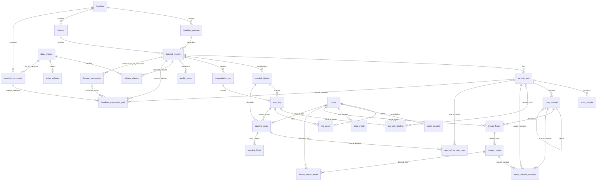

# Data Relationships and Read Paths

`interpretation_input` links results and spectral streams only with supporting evidence. `source_document`, `source_reference` and ingest records preserve that evidence. Branches and surveys are not fabricated; `dataset_segment` stores complete source sample ranges for the added datasets.

On 2026-09-24, the database contained 39 tables, 8 boreholes and 13 datasets. `v_borehole_composite_samples` selects confirmed 3D continuation samples; `v_borehole_dataset_full` exposes complete 2D ranges and independent axes. Images, spectra and results retain their source axes. See the [multi-dataset read contract](MULTI_DATASET_READ_CONTRACT.md).

Media reads follow release/dataset/axis/sample_no → original scan_sample depth → bound log values or spectra → Section image_region → row PNG and sample_index_linear indicator. See [MEDIA_READ_CONTRACT.md](MEDIA_READ_CONTRACT.md). The diagram below describes the original HTTP interface; media HTTP endpoints were not implemented in this snapshot.

Configuration resolves the local `root_key=etl4`; the database stores relative object keys. Storage adapters and replica locations can change without changing business or asset identities.

A sample is identified by its position within an axis; depths may repeat. Each release selects one immutable revision per dataset. Subsequent frontend pages must carry the previous response's `release_id` to avoid mixing versions when the default release changes.
