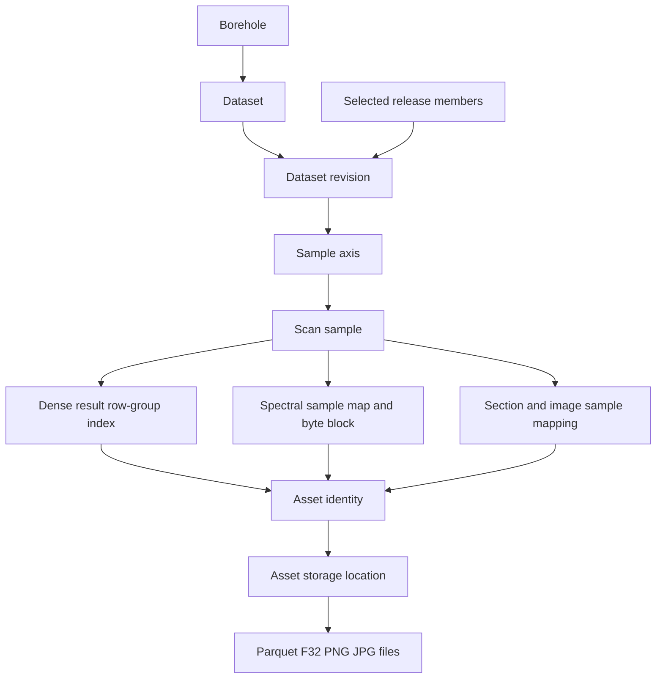

# Database Relationships and Scientific Boundaries

The database stores identity, metadata, sample depth, relationships and file indexes. External files contain large result arrays and image pixels. Becoming read only does not remove the existing tables or historical rows; queries consistently choose the fixed release.

This is a lookup diagram, with intermediate tables combined. It is not a declaration that every arrow is a direct foreign key. The schema dictionary gives the actual constraints.

| Group | Main relationships |
|---|---|
| Scope | active_release → data_release; release_dataset selects one dataset_revision for each dataset in the release |
| Identity | borehole → dataset → dataset_revision; borehole_revision supplies the recorded collar and source metadata |
| Samples | dataset_revision → sample_axis → scan_sample; (axis_id,sample_no) is the sample key |
| Physical intervals | core_interval contains tray and Section ranges; a Section belongs to a tray |
| Result metadata | scan_log identifies a result log; interpretation_set keeps algorithm family, interpretation region and s/u variant; metric_definition keeps metric semantics |
| Result binding | log_axis_binding identifies the verified sample axis used by the log |
| Dense files | data_chunk identifies a Parquet asset, row group and half-open source-row range |
| Spectra | spectral_array describes the F32 layout; spectral_sample_map maps samples to source rows; spectral_block indexes verified byte ranges; spectral_stream stores wavelengths |
| Images | image_frame refers to a tray image; image_region is a row crop region; image_sample_mapping associates that region with an axis/Section/sample interval; image_region_asset links the derived PNG |
| Storage | asset records byte size, SHA256 and provenance; asset_location records one or more physical replicas |
| Evidence | source_document, source_reference and quality_issue preserve source statements and limitations |

There are 261,892 current samples but only 1,361 row images. A row image covers a sample interval and is reused by all corresponding samples. The database does not store a separate PNG for each sample. The 3,042 current asset/location identities reference 2,810 unique physical files; multiple identities may reuse the same file.

The collar is a supplied WGS84 point, not a reconstructed hole trajectory. Missing orientation/elevation remains unknown. Mineral names and weights retain source semantics; no confidence algorithm is introduced. VSWIR/TIR physical spectra and VNIR/SWIR/TIR interpretation outputs are separate concepts. Missing TIR payloads are not inferred from available VSWIR. The existing thumbnails are an intentional source resolution limit, and row crops are lossless crops of those images rather than high-resolution downloads.

The empty interpretation_input table means algorithm-input relationships were not confirmed, not that mineral results are missing. Branch, segment and survey tables represent extension capability, not proof that the three reference holes were processed. This package's operational scope remains the five listed holes.
